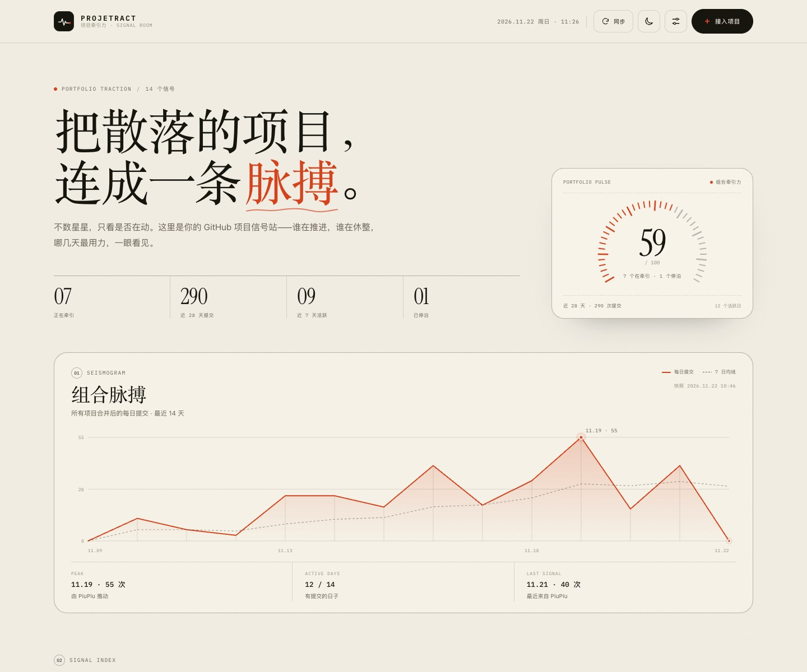
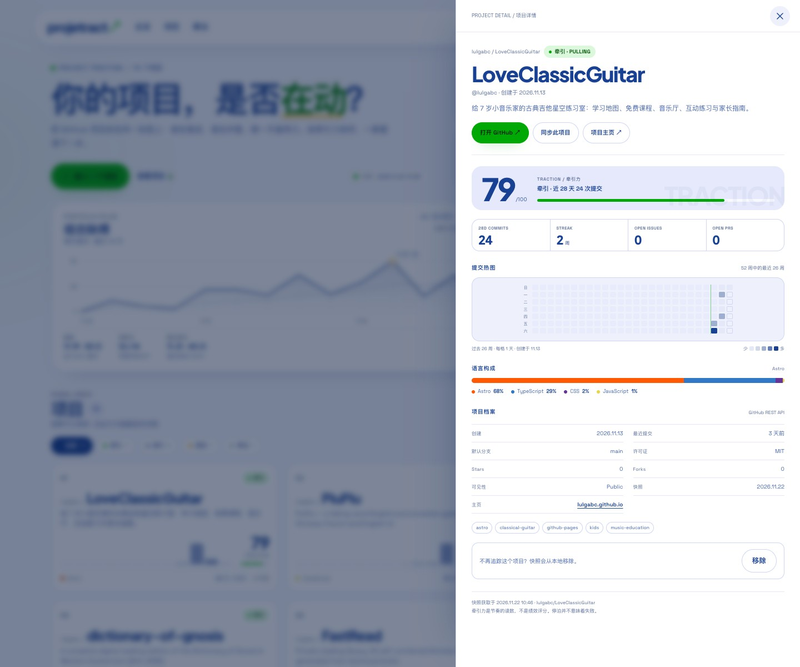

# Projetract

**项目牵引力 · SIGNAL ROOM**

把散落的项目，连成一条脉搏。

一个安静的控制室，用来看见你的 GitHub 项目是否真的在动。不数星星，只看牵引力。

**Live:** <https://lulgabc.github.io/projetract/>



## 它是什么

Projetract 是一个零依赖、零构建的单页 Web App。它把 GitHub 上的项目变成一张持续更新的信号面板：

- **组合脉搏** — 把最近 14 天的每日提交合并成一条波形，悬停能看见峰值那天由谁推动。
- **牵引力读数** — 每个项目一个 0–100 的节奏分数，由活动量、连续性、新鲜度和动量组成。
- **项目卡片** — 12 周提交柱、连续活跃周、语言、最后一次心跳，一屏读完。
- **详情抽屉** — 26 周提交热图、语言构成、Open Issues / PRs、项目档案和同步入口。
- **接入方式** — 粘贴 `owner/repo`，或者扫描一个 GitHub 用户名的公开仓库。
- **两份主题** — 纸感日间与夜间值守，随你喜欢。
- **本地优先** — 首屏用内嵌快照，不需要网络；数据只存在你的浏览器里。



## 快速开始

### 方式一：直接打开

双击 `index.html` 即可。`file://` 下也能完整运行，包括 localStorage 和 GitHub API。

### 方式二：本地服务（推荐）

```bash
cd projetract
python3 -m http.server 4173
```

然后打开 <http://127.0.0.1:4173>。

本地服务让 localStorage 的来源更稳定，也更接近部署后的行为。

### 部署到 GitHub Pages

这个目录本身就是一个完整的静态站点。推送到 GitHub 后，在仓库设置里选择 GitHub Pages，发布根目录即可。没有构建步骤。

## 常用操作

| 操作 | 入口 |
| --- | --- |
| 接入单个项目 | 右上角 **接入项目**，或按 `N` |
| 扫描用户名下的仓库 | **接入项目 → 扫描 GitHub** |
| 同步全部 | 右上角同步按钮，或按 `S` |
| 搜索项目 / 语言 / 话题 | 搜索框，或按 `/` |
| 查看项目详情 | 点击任意项目卡片 |
| 调整主题 / Token / 数据 | 右上角设置按钮 |

### 接入私有仓库

GitHub 的公开 API 不返回私有仓库。要追踪私有项目，在 **设置 → GitHub Token** 中粘贴一个 token：

- 建议使用 fine-grained token，只授予必要的 `repo` 权限。
- 默认只在当前标签页会话中保存；勾选「记住此令牌」后才会写入 `localStorage`。
- Token 不会写入项目文件，也不会经过任何中间服务器。所有请求直连 `api.github.com`。
- 添加 Token 后，API 配额会从每小时 60 次提升到 5,000 次。

## 数据与隐私

- 这是一个纯前端应用，没有后端，没有账号系统，没有分析脚本。
- 所有仓库数据、追踪列表和偏好都保存在浏览器的 `localStorage`（键名 `projetract.v1`）。
- 首屏数据来自 `seed.js`：一个内嵌的、@lulgabc 公开仓库的时间点快照（只包含公开仓库的元数据）。
- 私有仓库数据只会在你提供 Token 后由浏览器直接读取，并保存在你自己的浏览器中。
- 点击 **导出快照** 可以得到一份 JSON 备份；Token 不会被导出。

> 私有快照保存在本机。清除 Token 不会删除已经缓存的私有项目数据；如果不希望保留，请从看板中移除对应项目。

## 牵引力如何计算

牵引力（0–100）由四个透明的部分组成：

| 维度 | 权重 | 含义 |
| --- | --- | --- |
| 活动量 Activity | 35% | 最近 4 周的提交密度（24 次提交视为满格） |
| 连续性 Consistency | 25% | 最近 12 周中有多少周保持活跃（8 周视为满格） |
| 新鲜度 Recency | 20% | 距最后一次提交的时间，21 天为半衰期 |
| 动量 Momentum | 20% | 最近 4 周相对前 4 周的加速 / 减速 |

状态标签：

- **牵引** — 牵引力 ≥ 65
- **滑行** — 40–64
- **漂流** — 20–39，或超过 21 天没有活动
- **停泊** — 低于 20，或超过 60 天没有活动

它是一个观察节奏的仪器，不是绩效评分。停泊并不意味着失败，很多项目只是需要冬眠。

## 预置快照与同步

`seed.js` 由脚本直接从 GitHub 生成，用来保证打开页面时立刻有真实内容，也避免第一次打开就消耗匿名 API 配额。

重新生成快照（需要登录 `gh` CLI）：

```bash
gh auth login
node scripts/build-seed.mjs lulgabc --months=24
```

只包含该用户最近 24 个月内推送过的公开、非归档、非 fork 仓库。

### API 用量

- 接入 / 刷新一个项目：约 3–5 次请求。
- 同步全部：每个项目约 3 次请求。
- 匿名 GitHub API 上限为 60 次/小时；token 为 5,000 次/小时。
- 配额不足时应用会提示，并不会清空已有快照。

## 技术说明

- **单页静态应用**：HTML + CSS + 原生 JavaScript，零运行时依赖、零构建。
- **图表**：SVG / CSS 手绘，没有图表库。
- **字体**：Instrument Serif + IBM Plex Mono（Google Fonts），中文回退到系统宋体 / 苹方。断网时仍然可用。
- **兼容性**：面向现代浏览器（Chrome 117+、Safari 17+、Firefox 121+）。`color-mix()`、`:has()` 和 `@starting-style` 是渐进增强。
- **本地数据键**：`projetract.v1`；Token 键：`projetract.token`。

### 文件

```
index.html                 页面结构
styles.css                 全部视觉样式与响应式布局
app.js                     数据、评分、渲染与交互
seed.js                    内嵌的初始公开仓库快照
scripts/build-seed.mjs     用 gh CLI 重新生成 seed.js
docs/preview*.jpg          README 截图
```

## 快捷键

```
N     接入项目
/     聚焦搜索
S     同步全部
ESC   关闭弹层
```

---

**不数星星，只看是否在动。**
**NOT VANITY. TRACTION.**
